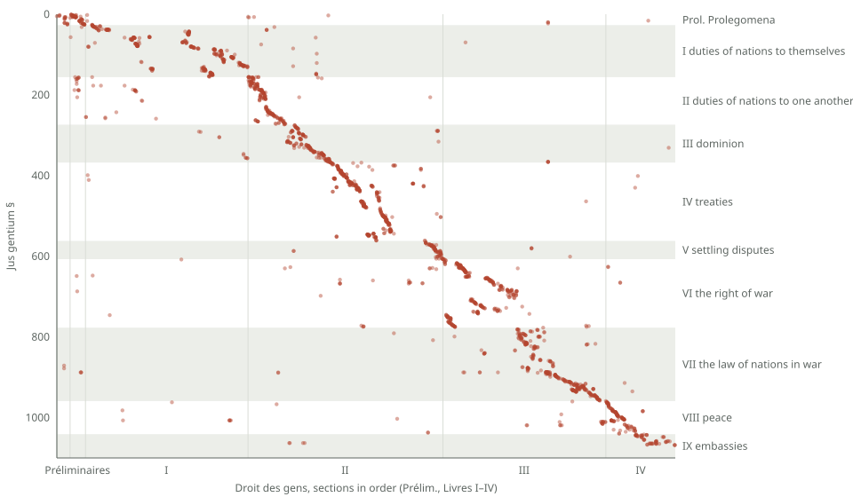

# Vattel's *Droit des gens* and Wolff's *Jus gentium*: the order of reuse

*Data report, generated from the edition vattel-1773 1.19 by `tools/reports/vattel_jus_gentium.py` on 2026-11-22. The numbers change when the table changes; the script writes them again.*

2,180 match rows tie 751 of the 1,124 sections of the *Droit des gens* (1773) to Wolff's *Jus gentium* (1749). 2,117 of them name a § of Wolff.

Vattel follows Wolff's order. Spearman's rank correlation between the place of a section in the *Droit des gens* and the § of Wolff it reuses is 0.93. The dots run along one diagonal, chapter after chapter of Wolff.

| Book | Sections | With a *Jus gentium* row | Wolff's chapters reused (share of the book's rows) |
|---|---|---|---|
| Préface | 24 | 8 (33%) | Prol. 90%, VII 10% |
| Préliminaires | 28 | 25 (89%) | Prol. 73%, II 18% |
| Livre I | 295 | 133 (45%) | I 88% |
| Livre II | 354 | 272 (77%) | IV 42%, II 23%, III 20% |
| Livre III | 296 | 239 (81%) | VII 50%, VI 45% |
| Livre IV | 127 | 74 (58%) | VIII 64%, IX 31% |

Wolff's chapters: Prol. §§ 1–26; I, duties of nations to themselves, from § 27; II, duties to one another, from § 156; III, dominion, from § 274; IV, treaties, from § 368; V, settling disputes, from § 562; VI, the right of war, from § 607; VII, the law of nations in war, from § 777; VIII, peace, from § 959; IX, embassies, from § 1041.

Chapters of eight sections or more with the smallest share of sections tied to the *Jus gentium*:

- Livre I ch. XII, *De la piété & de la religion*: 1 of 33 sections (3%).
- Livre I ch. XIII, *De la justice & de la police*: 2 of 19 sections (11%).
- Livre IV ch. IX, *De la maison de l'ambassadeur, de son hôtel, & des gens de sa suite*: 2 of 11 sections (18%).
- Livre I ch. V, *Des états électifs, successifs ou héréditaires, & de ceux qu'on appelle patrimoniaux*: 3 of 16 sections (19%).
- Livre II ch. XVII, *De l'interprétation des traités*: 14 of 61 sections (23%).
- Livre IV ch. VII, *Des droits, privileges & immunités des ambassadeurs & autres ministres publics*: 10 of 30 sections (33%).

Method: the rows are those of the edition's *Jus gentium* table at status match (`reuse/vattel-1773__wolff-jus-gentium-1749.json`). A row names a § of Wolff where its locus begins with "§". A section counts as tied when it has at least one such row. [Open the edition](../viewer/?ed=vattel-1773).
